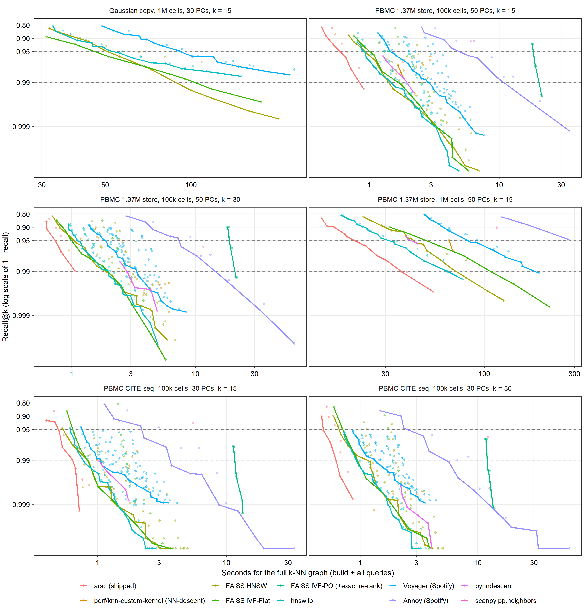

# scanpy / scverse parity

Inventory source: the 81 Jupyter notebooks of a published scanpy-based clinical single-cell analysis (reference workload),
code cells only, commented lines removed. About 850 scanpy/scverse calls; 294 are plotting (`sc.pl.*`,
`palantir.plot.*`, out of scope: arsc does not plot). Counts below are call counts across notebooks.
New code: `src/arsc/scanpy_extra.py`; tests: `tests/test_scanpy_extra.py` (19 tests, all pass; reference scanpy 1.11.5,
anndata 0.12.19). Validation data: 20,000-cell random subsample (seed 0) of a 132,989-cell CD8 T-cell dataset (3,000 HVG
counts), harmony PCs for graph steps (3,000 cells, because scanpy switches from exact to approximate kNN at 4,096 cells).

## Function map

| scanpy / scverse call (n) | Params used in the reference notebooks | arsc equivalent | Status | Validation vs scanpy |
|---|---|---|---|---|
| `sc.pp.calculate_qc_metrics` (20) | `qc_vars=[mt,ribo,hb]`, `percent_top=[20]`, `log1p=True` | `scanpy_extra.qc_metrics` | NEW | All 11 columns equal (max abs diff 1.4e-14) |
| `sc.pp.filter_cells/filter_genes` (1/3) | `min_genes=200`, `min_cells=3/10` | numpy on `qc_metrics` / column nnz | trivial, not wrapped | n/a |
| `sc.pp.normalize_total` (37) + `sc.pp.log1p` (50) | `target_sum=1e4` | `scanpy_extra.normalize_total_log1p` (`arsc.pp.log_normalize` equal to 1.8e-15) | NEW (bitwise) | max diff 0.0. Use the new one for rank tests: Seurat arithmetic `x/s*sf` differs by 1 ulp and changes tie structure |
| `sc.pp.normalize_per_cell` (12) | `counts_per_cell_after=1e4` | same as above | covered | same op as normalize_total |
| `sc.pp.highly_variable_genes` (31+) | default `seurat` with `n_top_genes` 2000/3000/4000/5000; `seurat_v3` on `layer="counts"`, 3000 | `scanpy_extra.highly_variable_genes` (`seurat`, `cell_ranger`, `seurat_v3`/`_paper`, `batch_key` for v3); v3 delegates to `arsc.pp.hvg_vst` | NEW | seurat/cell_ranger: gene set identical, means/dispersions 1e-14, dispersions_norm 3e-7 (scanpy stores float32). v3: `variances_norm` 3e-12, 999/1000 genes shared (the 1 swap is an exact tie at the cutoff). v3 with `batch_key`: norm. variance r > 0.999999, 940-950/1000 genes shared (ties) |
| `sc.pp.scale` (41) | `max_value=10` | `arsc.pp.scale` | covered | max diff 1e-13 |
| `sc.pp.regress_out` (1) | numeric covariates | `scanpy_extra.regress_out` (numeric, or single categorical key) | NEW | max diff 1e-13 |
| `sc.tl.pca` / `sc.pp.pca` (20+9) | `svd_solver='arpack'`, `n_comps=30/50` | `arsc.pp.pca` | covered | per-PC abs r >= 0.998 (arpack on 1,000 HVG vs gram), variance ratio diff 1.6e-5; scanpy 1.7 s vs arsc 0.46 s |
| `sce.pp.harmony_integrate` (12) | key = sample | `arsc.run_harmony` (R harmony port) | covered, NOT validated against harmonypy | validated vs R harmony 2.0.5 / 2.1.0 / 1.2 (see HARMONY_PARITY.md). harmonypy is a different port, so expect r ~0.99 per dim, not identity |
| `sc.pp.neighbors` (42) | `n_neighbors=30`, `use_rep='X_pca_harmony'`; 16 with `X_pca` euclidean / `X_scANVI` cosine | `scanpy_extra.neighbors` (kNN as scanpy: exact up to 4,096 cells, approximate above; + UMAP fuzzy simplicial set) | NEW | connectivities exact (max diff 0.0), distances 6e-14, euclidean and cosine |
| `sc.tl.leiden` (25+) | `resolution` 0.4-2.0, default `leidenalg`, `random_state=0` | `scanpy_extra.leiden` (`engine="arsc"`: own engine, igraph flavor) | NEW | labels identical (leidenalg res 0.5, 2.0; igraph flavor seeds 0 and 3), ARI 1.0; `engine="arsc"` agrees with scanpy as closely as scanpy's own seeds (ARI 0.688 vs 0.689 at 100k, "Clustering agreement") |
| `sc.tl.umap` (25+) | default, or `min_dist=0.4, spread=1.0` | `scanpy_extra.umap_from_connectivities` | NEW | coordinates identical (max diff 0.0) |
| `sc.tl.rank_genes_groups` (36+) | `method='wilcoxon'`, `pts=True`, `use_raw=True/False`, group by leiden / celltype / antigen_type | `scanpy_extra.rank_genes_groups` | NEW | wilcoxon (+ `tie_correct`), t-test, t-test_overestim_var, reference `rest` and a group: p-values equal to 1e-13, scores equal to float32 storage (rel 6e-8), pts exact |
| `sc.get.rank_genes_groups_df` (50) | `group=None` | the output of `rank_genes_groups` is already that table | covered | same columns: `group, names, scores, logfoldchanges, pvals, pvals_adj` (+ `pct_nz_group`, `pct_nz_reference`) |
| `sc.tl.score_genes` (51) | default, `ctrl_size=50`, `use_raw=False` | `scanpy_extra.score_genes` | NEW | exact (max diff 5e-15) incl. `ctrl_size`, `n_bins`, `random_state` variants |
| `sc.tl.dendrogram` (29) | `groupby` leiden / celltype | `scanpy_extra.dendrogram` | NEW | linkage 2.5e-8, same leaf order |
| `sc.get.obs_df` (4) | single gene extraction | column slice of `store.X()` | trivial | n/a |
| `palantir.utils.run_diffusion_maps` (10) | `n_components=5`, `pca_key='X_pca_harmony'` | `scanpy_extra.palantir_diffusion_maps` | NEW | eigenvalues 1e-10, kernel 5e-15, T 3e-16 (3,000 cells, exact-kNN regime) |
| `palantir.utils.determine_multiscale_space` (10) | default | `scanpy_extra.palantir_multiscale_space` | NEW | per-component abs r = 1.0 |
| `palantir.utils.run_magic_imputation` (10) | default `n_steps=3` | `scanpy_extra.magic_impute` | NEW | max diff 4e-6 (float32); 13x faster (T applied stepwise, T^3 never formed) |
| `palantir.core.run_palantir`, `presults.select_branch_cells`, `compute_gene_trends`, `cluster_gene_trends` (5/5/4/1) | `num_waypoints=500`, terminal states, `q=0.01, eps=0.01` | none | GAP | stochastic waypoint sampling, shortest paths and fate probabilities; not ported (see caveats) |
| `hotspot` (`legacy_init model='danb'`, `create_knn_graph`, `compute_autocorrelations`, `compute_local_correlations`, `create_modules`, `calculate_module_scores`) (1 each) | `n_neighbors=50`, `min_gene_threshold=150`, `core_only=True`, `fdr_threshold=0.05` | none | GAP | module scores were precomputed in the reference workload; not ported |
| `scv.tl.recover_dynamics`, `scv.tl.velocity` (1 each) | `dynamical`, `n_jobs=8` | none | GAP, single exploratory cell | out of scope |
| `gp.enrichr/prerank/ssgsea/get_library/read_gmt` (10/3/3/8/1) | various | `arsc.fgsea`, `arsc.genesets`, `arsc.score_ucell` for the prerank / rank-based cases | partial | Enrichr needs web access; use `arsc.de.fgsea` (validated vs R fgsea) |
| `dc.run_ulm`, `get_progeny`, `get_dorothea` (2/1/1) | `top=5000`; levels A-C | none (run decoupler directly) | not needed | single-call use on pseudobulk |
| `sm.OLS`, `sm.add_constant` (9) | `cov_type='cluster'/'HC3'` | statsmodels directly | n/a | |
| `ad.AnnData`, `ad.concat`, `var_names_make_unique`, `sc.settings.*`, `sc.logging.*` | | AnnData bookkeeping | n/a | |
| `sc.tl.diffmap`, `sc.tl.dpt` (not used in the notebooks, which used palantir) | | `scanpy_extra.diffmap`, `scanpy_extra.dpt` | NEW (bonus) | eigenvalues 1e-6 (scanpy float32), eigenvectors r = 1.0, DPT r = 0.99999999 |
| `sc.tl.paga`, `sc.tl.embedding_density` (not used) | | none | not implemented | not used in the notebooks |
| `sc.pl.*` (294), `palantir.plot.*` (36), `sm.set_array` | | plotting libraries | out of scope | |

## Speed: paired runs (same session, same threads)

**Speed gate, 10,000 cells, 16 cores** (2026-10-25 23:25, after the switch to arsc's own k-NN kernel;
`ARSC_SPEED_GATE=1 python -m pytest -q tests/test_speed_gate.py` under `tools/timing_lock.py run`): toy data of
`benchmarks/suite_sim.py` generated in memory, arsc and scanpy in one process, interleaved (alternating which runs first), 16 threads for
both, warm: every step is run once untimed first, so numba compilation is not in the times (first-call cost: see
the k-NN backend section). Median (min-max) of 3 runs each. 16 cores; other processes used 8.9% of the machine's
CPU on average during the run (at most 27.9%).

| Step | arsc | scanpy | speed-up (median) | slowest pair, arsc / scanpy |
|---|---:|---:|---:|---:|
| Log-normalize | 0.022 s (0.021-0.025) | 0.134 s (0.134-0.137) | **6.2x** | 0.18 |
| Highly variable genes (2,000) | 0.204 s (0.203-0.206) | 0.428 s (0.428-0.429) | **2.1x** | 0.48 |
| Scale + PCA (30 PCs) | 1.29 s (1.28-1.29) | 2.74 s (2.74-2.80) | **2.1x** | 0.47 |
| k-NN graph (k = 20) | 0.093 s (0.092-0.097) | 1.20 s (1.20-1.23) | **12.9x** | 0.08 |
| k-NN + Leiden clustering | 0.215 s (0.213-0.220) | 1.43 s (1.43-1.44) | **6.7x** | 0.15 |
| Markers, scanpy-style Wilcoxon | 0.515 s (0.510-0.522) | 2.77 s (2.73-2.78) | **5.4x** | 0.19 |
| Pseudobulk sums | 0.029 s (0.028-0.031) | 0.096 s (0.096-0.097) | **3.3x** | 0.32 |
| Pseudobulk DESeq2 (paired) | 1.55 s (1.47-1.72) | 2.12 s (1.93-2.19) | **1.4x** | 0.89 |
| scanpy gene-set score (5 sets) | 0.404 s (0.400-0.408) | 0.723 s (0.706-0.733) | **1.8x** | 0.58 |

Agreement in the same run: k-NN recall against exact neighbors arsc 0.993, scanpy 0.949 (overlap arsc-scanpy
0.943); Leiden ARI against the cell types arsc 0.995, scanpy 0.996, arsc-scanpy 0.997 (10 clusters each).

**10,000 and 100,000 real cells, 16 cores** (2026-10-26 22:42 and 22:47; `benchmarks/paired_bench.py --sizes
10000` and `--sizes 100000`, `--threads 16 --repeats 3 --quality`, each size under `tools/timing_lock.py run` with
nothing else admitted). arsc was faster than scanpy on all 9 steps at both sizes: 1.1x-16x at 10,000 cells and
1.3x-16x at 100,000 (median of 3 runs).

Notes:

* **Agreement.** k-NN recall against exact float64 neighbors of 2,000 query cells: arsc 0.996 / 0.990
  (10k / 100k), scanpy 0.949 / 0.949; arsc's overlap with scanpy (0.946 / 0.940) equals scanpy's overlap with
  itself under another seed (0.946 / 0.939). Clustering: arsc clusters scanpy's graph type (UMAP connectivities,
  Leiden with igraph's refinement) and agrees with scanpy within scanpy's own seed range (ARI arsc-scanpy 0.714 vs
  0.667 at 10k, 0.628 vs 0.647 at 100k). The factors are separated below ("Clustering agreement"). On these PBMC data, where 30% of cells carry the label "unidentified", both
  tools' ARI against the cell-type labels is about 0.1.
* **The slowest pair.** arsc's first DESeq2 run of each session was slower (2.5 s at 10k, 6.3 s at 100k, against
  1.6-1.8 s and 4.0 s for the next two), so its slowest pair loses to scanpy (0.9x, 0.8x); the medians favor arsc
  (1.1x, 1.3x).
* **Machine state.** Other processes used 10.0% of the machine's CPU on average at 10k (at most 56%, briefly)
  and 5.6% at 100k (at most 21%).

### Clustering agreement: graph, Leiden engine, seed

arsc's clustering agrees with scanpy's as closely as scanpy agrees with itself when it clusters the same kind of
graph. The gap in the first paired runs came from the graph: `arsc.find_neighbors(...)["snn"]` is Seurat's
`FindNeighbors` graph (Jaccard overlap of 20-neighbor sets, pruned below 1/15), which has twice the edges of
scanpy's UMAP connectivities (60 vs 30 per cell) and gives about 40% more clusters at the same resolution. That is
arsc's documented Seurat convention (`SEURAT_PARITY.md`), not a departure from it. Measured with
`benchmarks/cluster_factors.py` on the paired benchmark's 100,000-cell PBMC embedding (same 30 PCs, k = 20, Leiden
modularity at resolution 0.8, 2 iterations), 10 seeds per pipeline; ARI against scanpy's pipeline over all 100 seed
pairs (scanpy against itself: the 45 pairs of different seeds), on all cells; results in
`benchmarks/results/cluster_seed_matrix_100k.csv`:

| Graph | Leiden | ARI vs scanpy, mean (range) | ARI among own seeds | clusters | s per run |
|---|---|---|---|---|---:|
| scanpy (`sc.pp.neighbors`) | igraph (`sc.tl.leiden(flavor="igraph")`): **scanpy's pipeline** | **0.689** (0.553-0.785) | 0.689 | 18-22 | 5.2 |
| scanpy | leidenalg | 0.646 (0.478-0.796) | 0.621 | 17-22 | 7.5 |
| scanpy | arsc, leidenalg refinement (default) | 0.674 (0.554-0.785) | 0.657 | 18-21 | 1.6 |
| scanpy | arsc, leidenalg refinement, `n_iterations=-1` | 0.691 (0.562-0.802) | 0.693 | 18-21 | 34 |
| scanpy | arsc, igraph refinement | 0.697 (0.555-0.790) | 0.709 | 19-21 | 1.3 |
| arsc UMAP (`scanpy_extra.neighbors`) | igraph | 0.696 (0.560-0.881) | 0.686 | 19-21 | 5.6 |
| arsc UMAP | arsc, leidenalg refinement | 0.665 (0.545-0.814) | 0.653 | 17-21 | 1.3 |
| arsc UMAP | arsc, igraph refinement (**`scanpy_extra.leiden(flavor="igraph", engine="arsc")`**) | **0.688** (0.549-0.806) | 0.687 | 18-21 | 1.3 |
| arsc SNN (`find_neighbors`, Seurat) | igraph | 0.622 (0.463-0.693) | 0.802 | 28-29 | 7.9 |
| arsc SNN | arsc, leidenalg refinement (first paired runs) | 0.605 (0.472-0.676) | 0.768 | 26-28 | 1.7 |
| arsc SNN | arsc, igraph refinement | 0.617 (0.478-0.679) | 0.825 | 28-30 | 1.4 |
| arsc SNN, resolution 0.4 (cluster count matched) | arsc, leidenalg refinement | 0.535 (0.434-0.699) | 0.781 | 16-20 | 1.7 |

* **Graph.** Every pipeline on the SNN graph agrees with scanpy at ARI 0.61-0.62 whatever the engine, and
  lowering the resolution to match scanpy's cluster count makes it worse (0.535): the SNN graph partitions the
  cells differently, not just more finely. Single-seed resolution sweeps (0.3-1.2, every graph and engine;
  `benchmarks/results/cluster_factors_100k.csv`) show the same: the SNN graph gives 17-34 clusters where scanpy's
  gives 10-28.
* **Engine.** On scanpy's own graph, arsc's Leiden with leidenalg's refinement (its port of leidenalg, the
  Seurat engine) agrees with scanpy a little less than scanpy agrees with itself (0.674 vs 0.689), but more than
  leidenalg does (0.646). scanpy's `flavor="igraph"` runs igraph's `community_leiden`, whose refinement step is
  near-greedy (a well-connected singleton joins a community with probability proportional to exp(gain / 0.01))
  where leidenalg's picks a random neighbor; with 2 iterations igraph's is steadier. arsc now has igraph's
  refinement (`arsc.cluster(..., refinement="igraph")`), which closes the gap (0.697 on scanpy's graph, 0.688 on
  arsc's) at 1.3 s per run against igraph's 5.2 s. leidenalg's refinement run to convergence (`n_iterations=-1`)
  also closes it, at 34 s.
* **Seed.** One seed pair is not a measurement: scanpy against itself ranges 0.55-0.79. Pairs that share a seed
  and run igraph on nearly identical graphs share igraph's random stream, which inflates their ARI (the 0.881
  maximum of arsc UMAP + igraph).
* **`scanpy_extra.leiden(flavor="igraph")` RNG fixed.** It seeded igraph with `random.Random(seed)`; scanpy >= 1.10
  installs a numpy `RandomState(seed)` adapter, so the same seed gave a different partition (ARI 0.61 at 100k).
  It now uses scanpy's adapter and reproduces `sc.tl.leiden(flavor="igraph")` label for label (100k: ARI 1.0;
  3,000 cells: identical labels, seeds 0 and 3, `tests/test_scanpy_extra.py`). It also passes `n_iterations=-1`
  through to igraph as scanpy does (it had silently used 2).

Which to use: for Seurat's convention, `arsc.find_neighbors(...)["snn"]` + `arsc.cluster(method="leiden")`
(unchanged defaults). For scanpy's, `arsc.scanpy_extra.neighbors(emb, n_neighbors=k)["connectivities"]` +
`arsc.scanpy_extra.leiden(conn, res, flavor="igraph", n_iterations=2)` (scanpy's labels exactly) or the same with
`engine="arsc"` (an equally close partition, about 4x faster). The paired benchmark's arsc clustering step now
runs the latter (`ARSC_BENCH_CLUSTER=scanpy`, set by `paired_bench.py`).

Older paired runs: `benchmarks/results/paired/` (runs.jsonl, summary_*.csv) and the git history.

<!-- PAIRED:START -->
Same session, interleaved (arsc and scanpy alternate first), the same thread count for both; median (min-max) of the runs; machine state = system CPU use in the second before each run and the framework's CPU leases (other jobs on the shared machine). Real data: a deterministic subset (seed 0) of 10,000 or 100,000 cells of a 1.37M-cell PBMC store (36,601 genes, 32 patients, 36 cell-type labels), read memory-mapped and held in memory; nothing written to disk but these tables. Both tools in one process at 16 threads; every step run once untimed first (on a 12,000-cell toy dataset, so numba compilation is excluded).

**10,000 cells**:

| Step | arsc | scanpy | speed-up (median; slowest pair) | runs each | threads | CPU use before runs | agreement |
|---|---:|---:|---|---:|---:|---|---|
| Log-normalize | 0.02 s (0.02 s-0.02 s) | 0.12 s (0.12 s-0.12 s) | **6.3x**; 5.5x | 3 | 16 | 6-6% |  |
| Highly variable genes (2,000) | 0.20 s (0.20 s-0.20 s) | 0.41 s (0.40 s-0.41 s) | **2.1x**; 2.0x | 3 | 16 | 6-6% |  |
| Scale + PCA (30 PCs) | 0.49 s (0.48 s-0.49 s) | 1.21 s (1.19 s-1.22 s) | **2.5x**; 2.4x | 3 | 16 | 6-6% |  |
| k-NN graph (k = 20) | 0.08 s (0.07 s-0.08 s) | 1.22 s (1.19 s-1.22 s) | **15.8x**; 15.5x | 3 | 16 | 6-6% | recall vs exact: arsc 0.996, scanpy 0.949; overlap arsc-scanpy 0.946 vs scanpy seed 0-seed 1 0.946 |
| k-NN + Leiden clustering | 0.14 s (0.13 s-0.14 s) | 1.50 s (1.43 s-1.99 s) | **10.9x**; 10.8x | 3 | 16 | 6-6% | ARI arsc-scanpy 0.714 vs scanpy seed 0-seed 1 0.667 (15 / 15 / 16 clusters); vs the cell-type labels arsc 0.128, scanpy 0.126 |
| Markers, scanpy-style Wilcoxon (36,601 genes, 36 cell types) | 0.87 s (0.86 s-1.03 s) | 5.51 s (5.34 s-6.20 s) | **6.3x**; 5.4x | 3 | 16 | 6-6% |  |
| Pseudobulk sums (sample x cell type) | 0.10 s (0.10 s-0.11 s) | 0.27 s (0.25 s-0.29 s) | **2.6x**; 2.5x | 3 | 16 | 6-6% |  |
| Pseudobulk DESeq2 (paired) | 1.80 s (1.65 s-2.46 s) | 2.05 s (1.92 s-2.19 s) | **1.1x**; 0.9x | 3 | 16 | 6-6% |  |
| scanpy gene-set score (3 sets of 30 genes) | 0.23 s (0.23 s-0.24 s) | 0.39 s (0.39 s-0.40 s) | **1.7x**; 1.7x | 3 | 16 | 6-6% |  |

Run 2026-10-26 22:42:23 under the machine-wide timing lock (16 threads, 16 physical cores, 4 min including data loading and warm-up): other processes used 10.0% of the machine's CPU on average (at most 56.1%; 3.19 cores on average), sampled every second (228 samples).

**100,000 cells**:

| Step | arsc | scanpy | speed-up (median; slowest pair) | runs each | threads | CPU use before runs | agreement |
|---|---:|---:|---|---:|---:|---|---|
| Log-normalize | 0.19 s (0.16 s-0.22 s) | 1.23 s (1.23 s-1.24 s) | **6.5x**; 5.5x | 3 | 16 | 6-6% |  |
| Highly variable genes (2,000) | 1.27 s (1.26 s-1.27 s) | 3.69 s (3.69 s-3.69 s) | **2.9x**; 2.9x | 3 | 16 | 6-6% |  |
| Scale + PCA (30 PCs) | 1.73 s (1.72 s-1.76 s) | 9.67 s (9.66 s-9.73 s) | **5.6x**; 5.5x | 3 | 16 | 6-6% |  |
| k-NN graph (k = 20) | 0.67 s (0.67 s-0.70 s) | 2.48 s (2.46 s-2.51 s) | **3.7x**; 3.5x | 3 | 16 | 6-6% | recall vs exact: arsc 0.990, scanpy 0.949; overlap arsc-scanpy 0.940 vs scanpy seed 0-seed 1 0.939 |
| k-NN + Leiden clustering | 1.99 s (1.95 s-1.99 s) | 7.76 s (7.70 s-7.80 s) | **3.9x**; 3.9x | 3 | 16 | 6-6% | ARI arsc-scanpy 0.628 vs scanpy seed 0-seed 1 0.647 (18 / 20 / 21 clusters); vs the cell-type labels arsc 0.124, scanpy 0.120 |
| Markers, scanpy-style Wilcoxon (36,601 genes, 36 cell types) | 5.51 s (5.27 s-5.60 s) | 87 s (86 s-87 s) | **15.7x**; 15.3x | 3 | 16 | 6-6% |  |
| Pseudobulk sums (sample x cell type) | 0.19 s (0.18 s-0.20 s) | 0.84 s (0.84 s-0.85 s) | **4.4x**; 4.2x | 3 | 16 | 6-6% |  |
| Pseudobulk DESeq2 (paired) | 3.99 s (3.96 s-6.27 s) | 5.02 s (4.89 s-5.07 s) | **1.3x**; 0.8x | 3 | 16 | 6-6% |  |
| scanpy gene-set score (3 sets of 30 genes) | 1.74 s (1.73 s-1.74 s) | 3.43 s (3.41 s-3.43 s) | **2.0x**; 2.0x | 3 | 16 | 6-6% |  |

Run 2026-10-26 22:47:42 under the machine-wide timing lock (16 threads, 16 physical cores, 11 min including data loading and warm-up): other processes used 5.6% of the machine's CPU on average (at most 20.6%; 1.80 cores on average), sampled every second (645 samples).

<!-- PAIRED:END -->

## k-NN backend

**arsc uses its own k-NN kernel** (2026-10-25): it was the fastest backend at recall@k >= 0.95 and >= 0.99 on every
real dataset tested, ahead of FAISS (Meta), hnswlib, Voyager and Annoy (Spotify), pynndescent and scanpy. pynndescent
and scikit-learn are no longer used. `arsc.knn` (and `find_neighbors`, `scanpy_extra.neighbors`) searches exactly
up to 4,096 cells and approximately above, as scanpy.

* **Approximate** (`method="approximate"`, the default above 4,096 cells): a seeded k-means splits the cells into
  2 sqrt(n) clusters; every cell scans all cells of its 24 nearest clusters. The distances are float32 matrix
  products (BLAS) of the cells that probe a cluster and the cluster's cells, centered on its center; the k + 8 best
  candidates are re-scored exactly in float64 and ordered by (distance, index). Deterministic for a seed and
  independent of the thread count.
* **Exact** (`method="exact"`): the same partition, every cluster a candidate, skipped or narrowed by the triangle
  inequality, a float32 filter with a proven rounding margin and float64 distances: the exact k-NN at any size.

Time to build the full graph (build + every cell queries) at the cheapest setting of each library that reaches the
recall, from a parameter sweep of each library (FAISS IVF-Flat nlist/nprobe, IVF-PQ, HNSW M/efConstruction/efSearch;
hnswlib and Voyager M/ef; Annoy trees/search_k; pynndescent max_candidates/n_neighbors; arsc clusters/probes).
Recall@k is scored against exact float64 neighbors of 2,000 random cells (self included; ties counted). Data: real
PCs held in memory, never written: "PBMC CITE-seq" = the stored 30-PC PCA of a 260k-cell PBMC CITE-seq store,
100k random cells; "PBMC 1.37M" = 50 PCs (vst top 2,000 genes, log1p CP10k, z clip 10) of a 1.37M-cell PBMC store,
100k or 1M random cells. Pinned to the same 16 logical CPUs; most sweep points at 6 threads, arsc's and the later
1M points at 4 threads (the machine was shared), so arsc's lead at 100k is understated:

| Data | k | arsc | hnswlib | FAISS HNSW | FAISS IVF-Flat | Voyager | pynndescent | Annoy | scanpy |
|---|---:|---|---|---|---|---|---|---|---|
| PBMC CITE-seq, 100k, 30 PCs | 15 | **0.50 / 0.67 s** | 0.62 / 0.80 | 0.58 / 0.85 | 0.66 / 0.86 | 0.77 / 1.08 | 1.03 / 1.03 | 2.3 / 3.8 | recall 0.931 (best) |
| PBMC CITE-seq, 100k, 30 PCs | 30 | **0.49 / 0.63 s** | 0.73 / 0.98 | 0.68 / 1.21 | 0.80 / 1.13 | 0.86 / 1.38 | 2.2 / 2.2 | 3.5 / 5.7 | 12.2 / - |
| PBMC 1.37M, 100k, 50 PCs | 15 | **0.67 / 0.91 s** | 0.93 / 1.60 | 1.00 / 1.54 | 1.10 / 1.76 | 1.54 / 3.11 | 1.28 / 2.18 | 5.8 / 18 | recall 0.914 (best) |
| PBMC 1.37M, 100k, 50 PCs | 30 | **0.75 / 1.07 s** | 1.11 / 1.99 | 1.10 / 2.11 | 1.20 / 2.51 | 1.89 / 3.45 | 2.47 / 2.82 | 7.7 / 18 | 11.5 / - |
| PBMC 1.37M, 1M, 50 PCs | 15 | **23 / 37 s** | 33 / 64 | 44 / 80 | 58 / 110 | 85 / 195 | 45 / - | - / - | recall 0.902 |

Cells: seconds to reach recall 0.95 / 0.99 ("-": not reached in the sweep). The 1M row mixes 6 threads (hnswlib, FAISS)
and 4 threads (arsc, Voyager, pynndescent, Annoy, scanpy). A Gaussian copy of the CITE-seq PCs (1M cells, 30 dims) was
swept for the HNSW and IVF libraries before the sweep was stopped; arsc was not run on it.

**Confirmation at 1M cells, k = 15, everything at 4 threads, one run each, in memory** (`benchmarks/results/knn_backend/confirm_1m.csv`):
arsc defaults 22.4 s (recall 0.961); pynndescent (scanpy's settings) 46.8 s (0.958); hnswlib M 16 / ef 96 56.1 s (0.952);
FAISS HNSW M 32 / efSearch 32 71.0 s (0.957); FAISS IVF-Flat nlist 2,000 / nprobe 24 73.8 s (0.962); Voyager M 32 / ef 64
95.9 s (0.953); scanpy `pp.neighbors` 141.5 s (0.902). arsc is 2.1x faster than the next library at the same recall.

Defaults: 2 sqrt(n) clusters and 24 probes give recall 0.961-0.996 on the data above (k = 15 and 30); more probes
(`arsc.neighbors.APPROX_PROBE`) raise recall: 32 probes 0.978 and 48 probes 0.991 at 1M cells.

Every configuration: `benchmarks/results/knn_backend/sweep_points.csv`, frontiers `pareto.csv`.

First call in a fresh process (`benchmarks/cold_start.py --what knn`, 100,000 toy cells, 4 threads, 2026-10-25):
`arsc.knn` 7.1 s with an empty numba cache (one-off compilation) and 1.1 s once compiled kernels are cached on disk;
`scanpy.pp.neighbors` 50-55 s. pynndescent's own one-off compilation (about 30 s) is gone from arsc.

## Speed, earlier single measurements

Earlier unpaired timings (a 32-thread workstation, 2026-10) are in the git history of this file.

## Caveats
- scanpy stores `scores`, `logfoldchanges` and `dispersions_norm` as float32; "exact" means equal at that precision.
- `rank_genes_groups` expects log1p data (as scanpy: `logfoldchanges` use `expm1`). The notebooks ran it on `.raw` (log-normalized,
  all genes) in most places and on scaled `X` in a few; both paths work (negative values go through a dense rank path).
  Scanpy's Wilcoxon default is NOT tie-corrected and has no continuity correction, unlike `arsc.wilcoxauc` / Seurat.
- `neighbors`: arsc switches like scanpy (exact below 4,096 cells, pynndescent with scanpy's settings above). Above 4,096
  cells the graphs are compared by recall against exact neighbors, overlap with scanpy (against scanpy's own seed-to-seed
  overlap) and cluster ARI (paired table above). `n_neighbors` counts the cell
  itself as in scanpy.
- `highly_variable_genes`: `batch_key` is supported only for `seurat_v3`. Genes with exactly tied statistics at the top-n cutoff
  are broken arbitrarily by scanpy (unstable sort); tie order cannot be reproduced bit-for-bit.
- `score_genes` draws control genes from a local `RandomState(random_state)`, the same MT19937 stream scanpy draws after
  `np.random.seed`, so results match scanpy without touching the global RNG (`SEEDS.md`).
- scanpy's `leiden` default (leidenalg, directed graph, `n_iterations=-1`) is reproduced; scanpy warns that the default will change
  to igraph. Use `flavor="igraph"` (with `n_iterations=2`, as scanpy recommends) to get the future default; add
  `engine="arsc"` for arsc's own engine (not label-identical; equally close, "Clustering agreement").
- Palantir/hotspot validation used pip packages installed into a separate directory (scikit-misc 0.5.3,
  palantir 1.4.5, hotspotsc 1.1.3), not into the main environment; and the corresponding tests skip if the packages are absent.
- Not ported (GAPs): the Palantir pseudotime run itself (waypoints, fate probabilities, branch selection), Hotspot
  (danb autocorrelation, local correlations, modules), scVelo.
